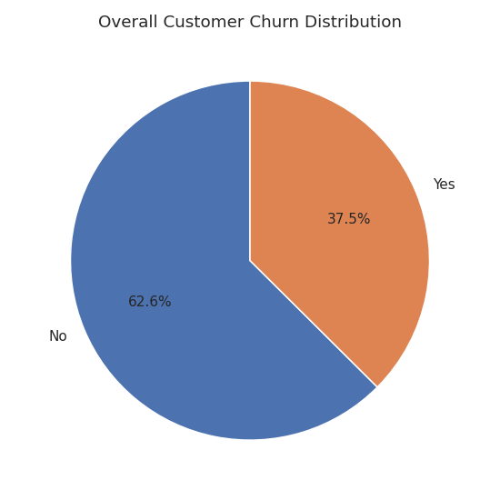
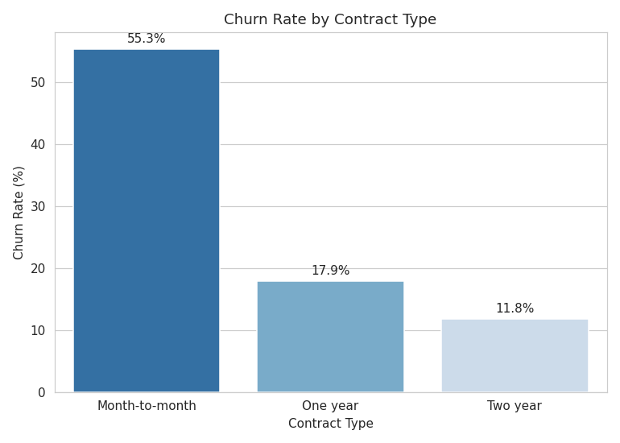
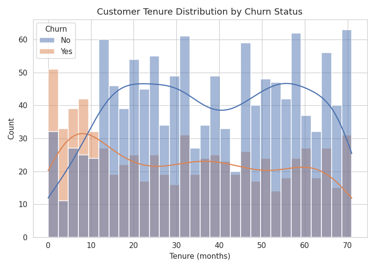
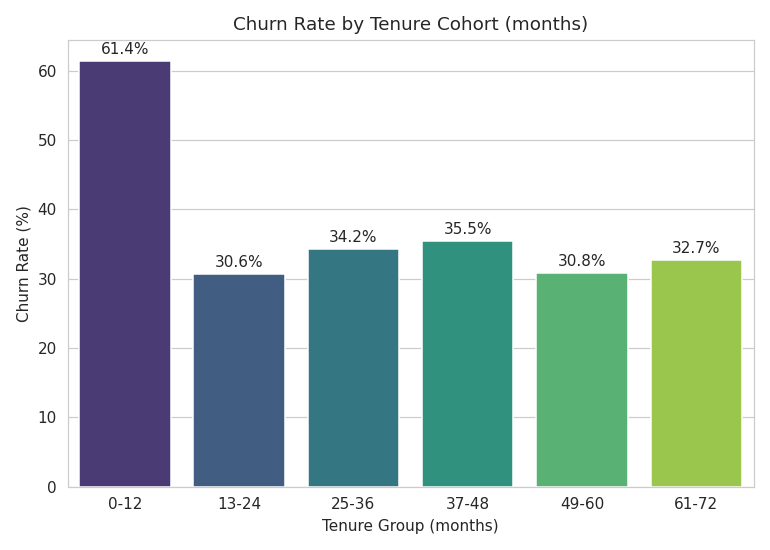
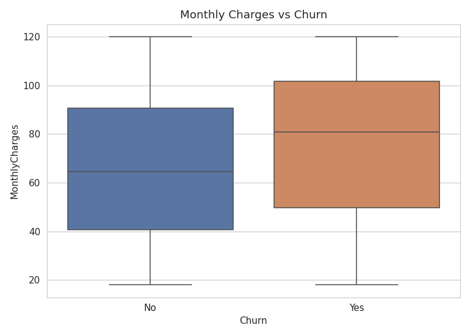
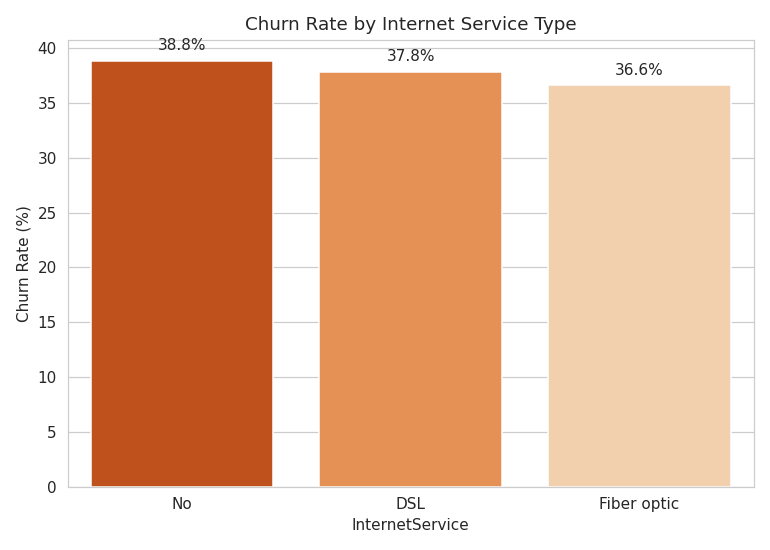
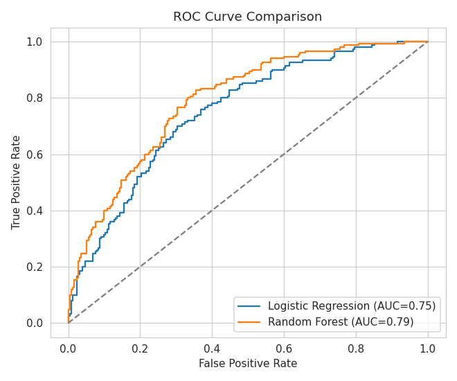
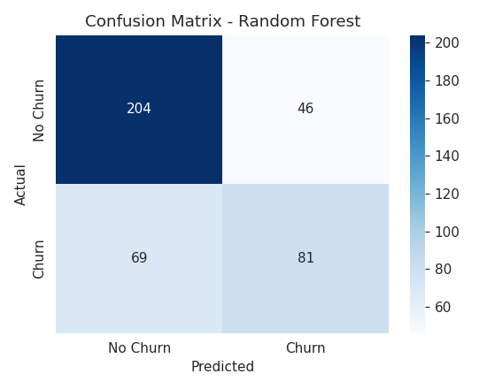
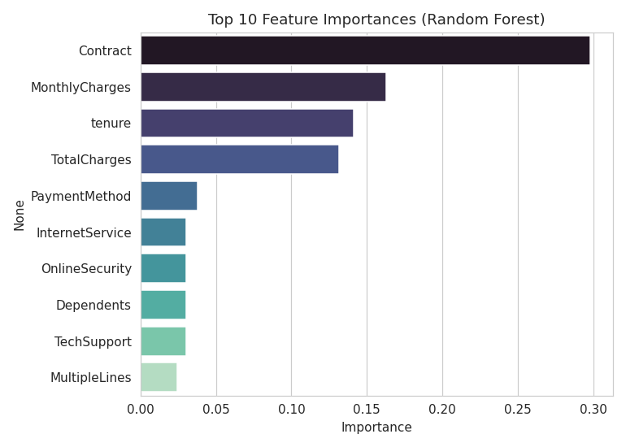

# Customer Churn Analysis & Prediction

An end-to-end data analysis project exploring customer churn behavior for a
telecom-style business — covering data cleaning, exploratory analysis, cohort
retention breakdown, and a baseline churn prediction model.

## Problem Statement
Customer churn (customers discontinuing a service) directly impacts revenue.
This project analyzes customer attributes — contract type, tenure, billing,
service usage — to understand **why customers churn** and builds a model to
**predict which customers are at risk**, so a business could proactively
intervene.

## Dataset
A synthetically generated dataset (`data/customer_data.csv`, 2,000+ records)
modeled on real-world telecom churn datasets, including intentional messiness
(missing values, duplicate records) to reflect realistic raw data. Generated
via `data/generate_dataset.py`.

**Features include:** demographics (gender, senior citizen, dependents),
account info (tenure, contract type, payment method), services subscribed
(internet, phone, tech support), and billing (monthly/total charges).

**Target:** `Churn` (Yes/No)

## Project Structure
```
customer-analysis/
├── data/
│   ├── generate_dataset.py     # generates the synthetic dataset
│   └── customer_data.csv       # the dataset used for analysis
├── images/                     # all generated charts (referenced below)
├── analysis.py                 # full analysis pipeline (cleaning → EDA → model)
├── requirements.txt
└── README.md
```

## How to Run
```bash
pip install -r requirements.txt
python3 data/generate_dataset.py   # generates data/customer_data.csv
python3 analysis.py                # runs full analysis, saves charts to images/
```

## Data Cleaning
- Removed duplicate customer records (identified via `customerID`)
- Handled missing `TotalCharges` values by estimating from `tenure x MonthlyCharges`
- Verified data types and consistency across categorical fields

## Key Findings

**1. Overall churn rate**


**2. Contract type is the strongest churn driver** — month-to-month customers
churn at a dramatically higher rate than customers on annual contracts.


**3. New customers are far more likely to churn** — the highest-risk window
is within the first 12 months of tenure.



**4. Higher monthly charges correlate with higher churn**, suggesting
price sensitivity among at-risk customers.


**5. Fiber optic internet customers churn more** than DSL or no-internet
customers — potentially indicating service/pricing dissatisfaction.


## Churn Prediction Model
Two baseline models were trained and compared:

| Model | ROC-AUC | Accuracy |
|---|---|---|
| Logistic Regression | 0.75 | 0.70 |
| Random Forest | **0.79** | 0.71 |




**Top predictive features:**


Contract type, tenure, and monthly charges emerged as the most important
predictors of churn — aligning with the EDA findings above.

## Business Recommendations
1. **Incentivize longer contracts** — offer discounts for switching from
   month-to-month to annual plans, given the sharp churn drop-off.
2. **Focus retention efforts on the 0–12 month cohort** — this is the
   highest-risk window; consider onboarding check-ins or early loyalty perks.
3. **Review fiber optic pricing/service quality** — investigate why this
   segment churns more than other internet service types.
4. **Deploy the churn model proactively** — flag high-risk customers
   (via predicted probability) for retention outreach before they churn.

## Tools Used
Python · Pandas · NumPy · Matplotlib · Seaborn · Scikit-learn

## Author
*Add your name/LinkedIn here before pushing*
