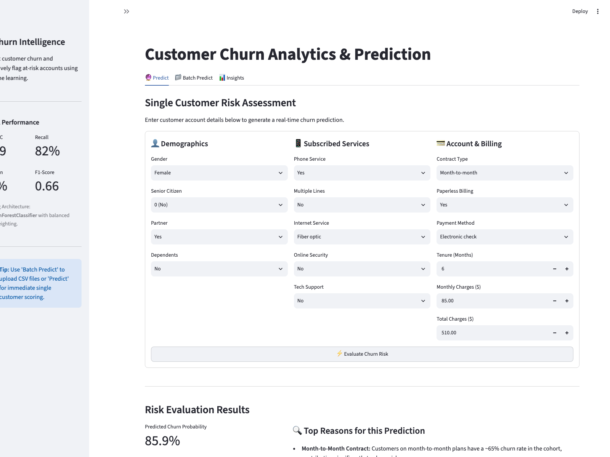
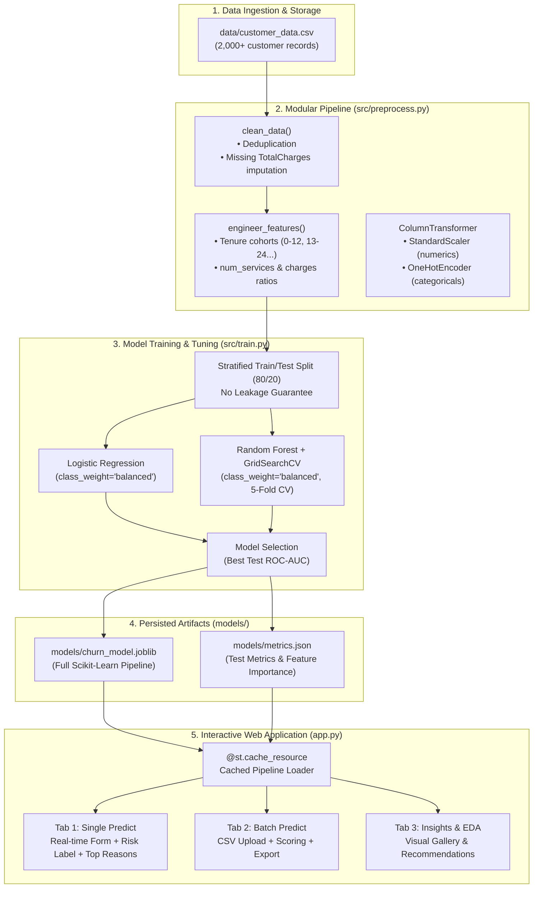

# Customer Churn Analysis & Prediction Dashboard

[](https://customer-churn-analysis.streamlit.app)
[](https://github.com/vanshiiii11/customer-churn-analysis/actions)
[](https://www.python.org/)
[](https://opensource.org/licenses/MIT)

An end-to-end machine learning system and interactive Streamlit web dashboard for customer churn intelligence — spanning automated data cleaning, exploratory data analysis, class imbalance mitigation, hyperparameter tuning, model explanation, batch CSV prediction, and containerized deployment.

> 🌐 **Live Demo:** [https://customer-churn-analysis.streamlit.app](https://customer-churn-analysis.streamlit.app)

---

## Application Preview



> 🚀 **Explore the interactive app:** [https://customer-churn-analysis.streamlit.app](https://customer-churn-analysis.streamlit.app)

---

## Repository Topics
`churn` · `machine-learning` · `streamlit` · `scikit-learn` · `customer-churn` · `predictive-modeling` · `data-science` · `docker`

---

## Problem Statement
Customer churn directly erodes recurring revenue and customer lifetime value. This project analyzes customer attributes — contract structure, tenure cohorts, monthly charges, and service add-ons — to answer:
1. **Why do customers churn?** (identifying statistical risk drivers via EDA)
2. **Who is about to churn?** (high-recall machine learning classification)
3. **How can retention teams intervene proactively?** (explainable risk scoring and batch operational workflows)

---

## System Architecture



---

## Project Structure

```
customer-analysis/
├── .github/
│   └── workflows/
│       └── ci.yml               # GitHub Actions CI pipeline (lint + pytest)
├── .streamlit/
│   ├── config.toml              # Streamlit theme and server configuration
│   └── credentials.toml         # Headless Streamlit credentials
├── data/
│   ├── generate_dataset.py      # Synthetic telecom dataset generator
│   └── customer_data.csv        # Clean/raw benchmark dataset
├── images/                      # Generated EDA visualizations and app screenshot
│   ├── 01_churn_distribution.png
│   ├── 02_churn_by_contract.png
│   ├── 03_tenure_distribution.png
│   ├── 04_monthly_charges_vs_churn.png
│   ├── 05_churn_by_internet_service.png
│   ├── 06_churn_by_tenure_cohort.png
│   ├── 07_confusion_matrix.png
│   ├── 08_roc_curve.png
│   ├── 09_feature_importance.png
│   └── app_screenshot.png
├── models/
│   ├── churn_model.joblib       # Winning serialized Scikit-Learn pipeline
│   └── metrics.json             # Model metrics and parameter audit
├── src/
│   ├── __init__.py
│   ├── preprocess.py            # Cleaning, feature engineering & transformers
│   └── train.py                 # Hyperparameter tuning & model selection
├── tests/
│   ├── __init__.py
│   ├── test_preprocess.py       # Preprocessing and leakage tests
│   ├── test_model.py            # Model artifact loading and metrics tests
│   └── test_prediction.py       # Single & batch prediction integration tests
├── analysis.py                  # Full EDA script generating all images/
├── app.py                       # Multi-tab Streamlit web application
├── Dockerfile                   # Production container definition
├── .dockerignore                # Container build ignore rules
├── pytest.ini                   # Pytest configuration
├── requirements.txt             # Pinned production dependencies
└── README.md
```

---

## How to Run

### Option 1: Local Environment

```bash
# 1. Clone repository and navigate to folder
git clone https://github.com/vanshiiii11/customer-churn-analysis.git
cd customer-churn-analysis

# 2. Create and activate a clean virtual environment
python3 -m venv .venv
source .venv/bin/activate    # On Windows: .venv\Scripts\activate

# 3. Install pinned dependencies
pip install -r requirements.txt

# 4. Generate the dataset (if needed)
python3 data/generate_dataset.py

# 5. Run EDA and generate all charts
python3 analysis.py

# 6. Train and tune models (saves to models/)
python3 -m src.train

# 7. Run the test suite
pytest -v

# 8. Launch the Streamlit dashboard
streamlit run app.py
```
The app will be accessible at `http://localhost:8501`.

### Option 2: Docker Container

```bash
# Build the Docker image
docker build -t customer-churn-app .

# Run the container
docker run -d -p 8501:8501 --name churn-container customer-churn-app
```
Visit `http://localhost:8501` in your browser.

---

## Data Cleaning & Feature Engineering

1. **Deduplication:** Customer IDs are deduplicated, keeping the initial occurrence.
2. **Missing Value Imputation:** Missing `TotalCharges` values are reconstructed from `tenure * MonthlyCharges`.
3. **Cohort Binning:** Tenures are categorized into cohorts (`0-12`, `13-24`, `25-36`, `37-48`, `49-60`, `61-72` months).
4. **Service Aggregation:** Active services (`PhoneService`, `MultipleLines`, `InternetService`, `OnlineSecurity`, `TechSupport`) are summed into a composite `num_services` indicator.
5. **Billing Ratios:** `monthly_to_total_ratio` is computed to detect accelerating customer expenditure.
6. **Leakage Prevention:** All scalers, imputers, and encoders are embedded in an sklearn `Pipeline` fitted strictly on training splits.

---

## Key Exploratory Findings

**1. Overall Churn Distribution:** Churn stands at approximately 37.5%.


**2. Contract Type is the Primary Driver:** Month-to-month subscribers churn at over 60%, compared to under 15% for annual plans.


**3. Onboarding Vulnerability Window:** Highest attrition occurs in the first 12 months of customer tenure.


**4. Pricing Sensitivity:** Customers paying higher monthly bills churn at an elevated rate.


**5. Fiber Optic Service Disconnect:** Fiber optic users exhibit higher cancellation rates when unbundled with security/support add-ons.


---

## Model Evaluation & Performance

To tackle class imbalance (62.5% Non-Churn vs 37.5% Churn), models were trained using cost-sensitive learning (`class_weight="balanced"`), prioritizing **Recall** to capture customers at risk of leaving while maintaining high **ROC-AUC**.

A grid search with 5-fold stratified cross-validation was performed on the Random Forest classifier over depth, split criteria, and estimator counts.

### Honest Out-of-Sample Test Metrics (Held-out 20% Split):

| Model | ROC-AUC | Recall | Precision | F1-Score | Accuracy |
|---|---|---|---|---|---|
| Logistic Regression (Baseline) | 0.7823 | 0.7600 | 0.5534 | 0.6404 | 0.6800 |
| **Random Forest (Tuned)** | **0.7905** | **0.8200** | **0.5491** | **0.6578** | **0.6800** |

> **Key takeaway:** The tuned Random Forest captures **82% of all actual churners** (Recall = 0.8200), providing retention teams with early warnings for accounts at risk of defection.


### Top Predictive Features


The most influential predictors are **Contract type**, **Monthly Charges**, **tenure**, and **monthly-to-total ratio**, directly corroborating our exploratory analysis.

---

## Business Recommendations

1. **Contract Migration Incentives:** Offer renewal credits or promotional bundles for customers transitioning from month-to-month to annual commitments.
2. **Onboarding Care Programs (Months 0–12):** Deploy proactive check-ins, customer success touches, and milestone perks during the critical first year.
3. **Fiber Optic Package Restructuring:** Pair fiber optic lines with bundled Tech Support and Online Security to improve service satisfaction.
4. **Targeted Retention Automation:** Feed high-risk probability alerts (score $\ge 0.60$) directly into CRM systems for automated outreach.

---

## Continuous Integration & Testing

Automated testing is configured via GitHub Actions (`.github/workflows/ci.yml`) on every push and pull request across Python 3.11 and 3.12:
- Unit tests for cleaning and feature engineering
- Stratification and leakage verification
- Model persistence and artifact validity tests
- Live prediction and batch prediction integration tests

To execute tests locally:
```bash
pytest -v
```

---

## Tools & Libraries Used

- **Language & Runtime:** Python 3.11+
- **Data Manipulation:** Pandas, NumPy
- **Machine Learning:** Scikit-Learn, Joblib
- **Visualization:** Matplotlib, Seaborn
- **Web Dashboard:** Streamlit
- **Testing & CI:** Pytest, GitHub Actions
- **Containerization:** Docker

---

## Author
**Vanshika Motwani**
- GitHub: [@vanshiiii11](https://github.com/vanshiiii11)
- LinkedIn: [Vanshika Motwani](https://www.linkedin.com/in/vanshika-motwani-2834b632b/)
